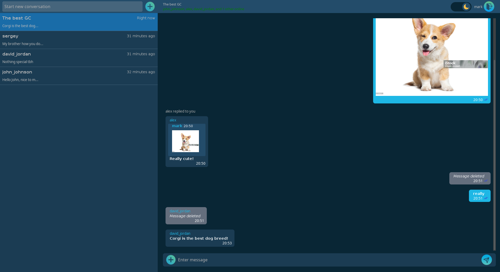
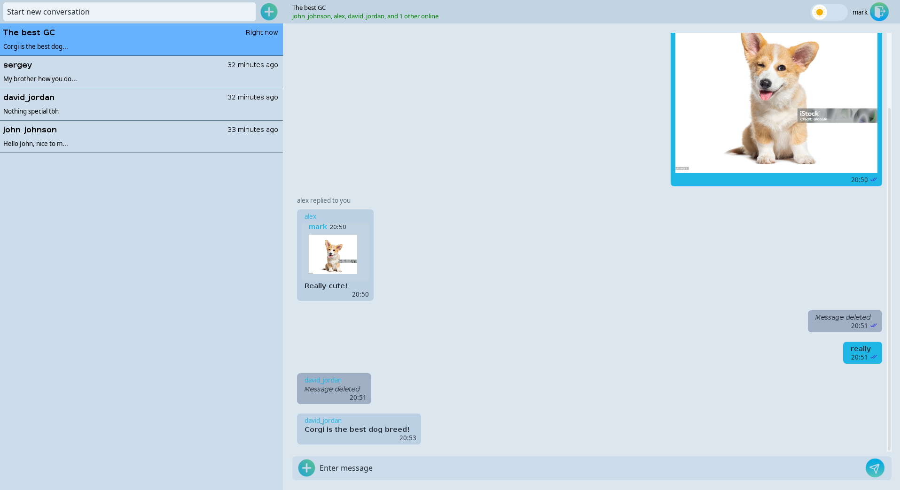

# Chat App

A desktop messaging application built with Java, featuring real-time communication, private and group chats, JWT authentication, and a Spring Boot backend.

The project is designed around a modular architecture that separates the desktop client, shared data models, HTTP API, and real-time messaging server. It also explores secure communication via ssl/tls, local message caching, database migrations, and containerized deployment.

## Features

- **User authentication** — JWT-based authentication with access and refresh tokens.
- **Private messaging** — One-to-one conversations between users.
- **Group chats** — Create group conversations.
- **Real-time messaging** — Persistent TCP connections for low-latency message delivery.
- **Message status tracking** — Sent, delivered, and seen message statuses.
- **Image messaging** — Send images in conversations.
- **Message replies** — Reply to existing messages with contextual references.
- **User search** — Find other users to start conversations.
- **Presence tracking** — See online which users in the chat are online, user statuses update live.
- **Local message caching** — SQLite-backed client cache for faster chat loading.
- **Secure transport** — HTTPS for the REST API and TLS for socket communication.
- **Database migrations** — Version-controlled database schema changes with Flyway.
- **Containerized deployment** — Docker and Docker Compose for running the backend and database.

## Screenshots

### Dark theme


### Light theme


## Tech Stack

| Component | Technologies |
|---|---|
| Language | Java 17 |
| Backend | Spring Boot 3.5.16 |
| Security | Spring Security, JWT |
| HTTP communication | REST API over HTTPS |
| Real-time communication | Java TCP sockets with TLS |
| Desktop client | Java Swing, FlatLaf look and feel|
| Main database | MySQL 8 |
| Local client cache | SQLite |
| Database migrations | Flyway |
| Build system | Maven |
| Containerization | Docker, Docker Compose |
| Testing | JUnit, Mockito for mocking, Test containers |

## Architecture

The application is organized as a Maven multi-module project.

```text
chat-app/
├── chat-common/
│   └── Shared DTOs and data models
│
├── chat-server/
│   ├── REST API
│   ├── Authentication and authorization
│   ├── Persistence and database access
│   ├── Message and chat management
│   └── TCP socket server
│
├── chat-client/
│   ├── Swing desktop interface
│   ├── HTTP API client
│   ├── TCP socket client
│   ├── Local SQLite cache
│   └── Client-side security utilities
│
├── pom.xml
└── docker-compose.yml
```

### Communication flow

The application uses two separate communication channels:

- **REST API:** Handles operations such as authentication, user lookup, and chat-related requests over HTTPS.
- **TCP socket connection:** Handles real-time messaging, presence updates, message status events, and connection keepalive.

The desktop client communicates with the backend through a controller layer that coordinates HTTP requests, socket events, local caching, and UI updates.

The backend uses MySQL for persistent application data, while the desktop client maintains a local SQLite cache to reduce unnecessary database-backed requests and improve the user experience.

### Why separate HTTP and TCP?

HTTP provides a natural interface for request-response operations, while a persistent TCP connection allows the server to push events to connected clients without requiring continuous polling.

Using separate channels also makes it possible to evolve the REST API and real-time messaging protocol independently.

## Security

Security is an important part of the application's design.

- **JWT authentication:** Access and refresh tokens support authenticated sessions.
- **Spring Security:** Protects backend endpoints and enforces authentication and authorization.
- **HTTPS:** Encrypts HTTP communication between the client and server.
- **TLS-protected TCP:** Encrypts the real-time socket connection.
- **Password hashing:** Uses Argon2-based password hashing.
- **Encrypted local token storage:** Uses AES-GCM encryption for locally stored refresh-token data.
- **Database isolation:** The production deployment is intended to keep MySQL on a private Docker network rather than exposing it publicly.
- **Configuration through environment variables:** Sensitive configuration is supplied externally instead of being hardcoded into the application.

TLS certificate trust must be configured correctly on both the server and client. Encryption alone does not guarantee that the client is communicating with the intended server.

**Security note:** Never commit private keys, keystores, keystore passwords, JWT secrets, database credentials, or production environment files to the repository. The client-side security mechanisms are intended to improve protection on the user's device, not to guarantee protection against a user who controls that device.

## Getting Started

### Prerequisites

To build and run the project locally, you will need:

- Java 17
- Maven
- MySQL 8, or Docker with the Docker Compose plugin
- Git

Docker is the recommended option for running the backend and database together.

### 1. Clone the repository

```bash
git clone https://github.com/YOUR_USERNAME/chat-app.git
cd chat-app
```

Replace `YOUR_USERNAME` with your GitHub username.

### 2. Configure environment variables

Create a local `.env` file based on the provided example:

```bash
cp .env.example .env
```

Configure the required database credentials, database URL, JWT secret, upload directory, and TLS keystore settings.

Typical configuration variables include:

| Variable | Purpose |
|---|---|
| `SPRING_PROFILES_ACTIVE` | Selects the Spring configuration profile |
| `DB_URL` | JDBC connection URL |
| `DB_USERNAME` | Database username |
| `DB_PASSWORD` | Database password |
| `JWT_SECRET` | Secret used for JWT signing |
| `TLS_KEYSTORE_PASSWORD` | Server keystore password |
| `IMAGE_DIR` | Directory for uploaded images |
| `SOCKET_PORT` | TCP socket server port |

The exact variables and required values depend on the configuration files included in the repository. Check `.env.example` and the Spring configuration before starting the application.

**Important:** Use your own development credentials and TLS keystore. Do not use production secrets in local development or commit your `.env` file.

### 3. Prepare TLS certificates

The server requires a TLS keystore for HTTPS and secure socket communication.

For local development, create a development certificate and keystore configured for `localhost`. Ensure that the certificate's Subject Alternative Name (SAN) matches the hostname used by the client.

The desktop client must trust the appropriate certificate authority or certificate, according to the project's client TLS configuration.

Development certificates should be separate from production certificates.

### 4. Start the backend and database

From the project root, build and start the Docker Compose services:

```bash
docker compose up --build -d
```

Inspect the service status:

```bash
docker compose ps
```

Follow the application logs:

```bash
docker compose logs -f app
```

The development configuration uses the following ports by default:

| Service | Port |
|---|---:|
| HTTPS API | 8443 |
| Real-time TCP socket | 5000 |
| MySQL host mapping | 3307 |

These ports are configurable. The MySQL host mapping is intended for development; production deployments should generally keep the database inaccessible from the public network.

### 5. Build the project with Maven

To compile and package the complete multi-module project:

```bash
mvn clean package
```

To build the server module together with its dependencies:

```bash
mvn clean package -pl chat-server -am
```

To build the desktop client together with its dependencies:

```bash
mvn clean package -pl chat-client -am
```

The build produces module artifacts under their respective `target/` directories.

### 6. Run the desktop client

Once the backend is running and the client is packaged, launch the desktop application using the packaging method supported by the current build.

For a directly executable JAR, the launch command is:

```bash
java -jar chat-client/target/chat-client-1.0-SNAPSHOT.jar
```

The JAR must include its runtime dependencies and a valid main-class manifest. If you use a shaded JAR or another packaging configuration, use the artifact name generated by that build.

The client also requires its TLS trust configuration and a reachable backend.

## Database and Persistence

The project uses different storage mechanisms for server-side persistence and client-side caching.

**MySQL**
- Stores persistent application data.
- Is managed through Spring's data-access layer.
- Uses Flyway for versioned schema migrations.

**SQLite**
- Maintains a local cache of conversations and messages.
- Supports cache-first loading of chat history.
- Can synchronize cached data with the backend.

The local cache is not a replacement for the server database. Server-side data remains the authoritative source of truth for shared conversations and message state.

## Docker and Deployment

The backend is containerized using a multi-stage Docker build.

The build stage compiles the Maven application, while the runtime stage uses a Java 17 runtime image. The container is designed to run as a non-root user.

Docker Compose brings together the application and MySQL, with persistent volumes for database data and uploaded images.

The intended production deployment separates public application traffic from private database traffic and supplies secrets and TLS material outside the public source repository.

## Project Structure

| Module | Responsibility |
|---|---|
| `chat-common` | Shared DTOs and models used across modules |
| `chat-server` | Backend API, authentication, persistence, and real-time socket communication |
| `chat-client` | Desktop UI, networking, local caching, and client-side functionality |

This separation helps keep the transport layer, shared contracts, persistence, and presentation concerns from becoming tightly coupled.

## License

No license has been specified yet. Unless a license is added to the repository, the source code is not automatically granted an open-source license, and normal copyright restrictions apply.

## Author

Developed as a personal project exploring Java desktop development, backend architecture, secure networking, authentication, persistence, and containerized deployment.

